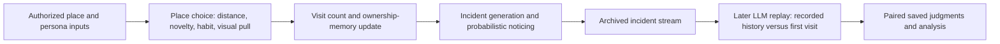
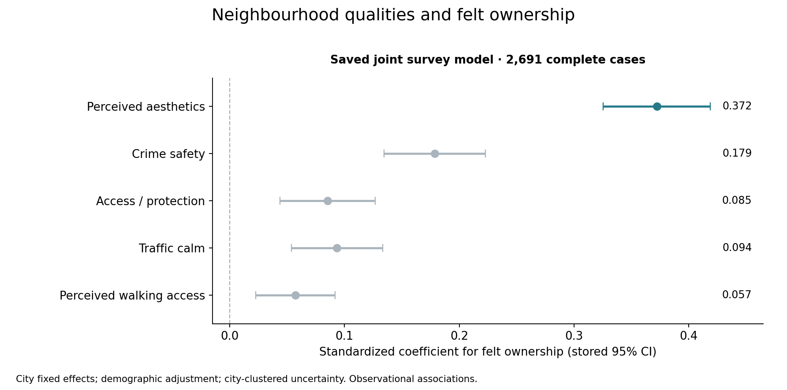
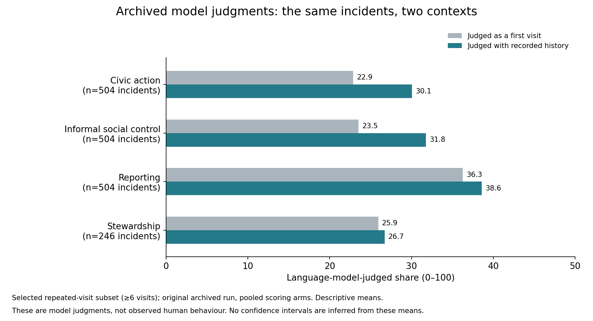

# Inviting neighbourhoods: original agent workflow and archived replay methods

## Research question

How do neighbourhood qualities relate to people's sense that a place is theirs to care for, and how might repeated encounters with a place relate to civic responses?

The broader project combines geographic analyses, surveys and archived agent-based modelling. This repository now exposes the **actual agent functions, original manual settings, survey-to-persona transformation, full replay prompt program and replay-analysis functions**, alongside selected saved aggregate results.

## Start with the executed notebooks

- **[Agent methods walkthrough — executed](notebooks/METHODS_WALKTHROUGH_EXECUTED.ipynb):** shows original configuration, place choice, state updates, incident handling, the original single-area runner and the later replay prompts. It imports and inspects code without simulating agents or calling a provider.
- **[Selected results — executed](notebooks/SELECTED_RESULTS_EXECUTED.ipynb):** redraws the existing survey coefficients and aggregate archived-judgment means.

## The agent process



The archived simulation uses specified equations for movement, memory and noticing. In the primary engine, visual scores affect place choice but do not directly enter the ownership-update multiplier. The later replay presents the same noticed incident with recorded history and as a first visit; its prompts omit place identity, imagery, visual score and the numeric ownership-memory state. History includes both visit count and prior noticed problems.

The **older simulation audit and formula-based reporting propensity** remain visible in the original runner. They are separate from the later replay outcomes displayed in the saved-results figure. Elicited ownership is also separate from simulated ownership memory. The source preserves these distinctions rather than replacing the original functions with generic interfaces.

## Source reading order

| Stage | Actual source |
|---|---|
| Original settings, agent state, place choice, memory/noticing equations, older audit prompt and full single-area runner | [archived_simulation.py](code/agents/archived_simulation.py) |
| Original questionnaire-item transformations into agent dispositions | [persona_mapping.py](code/agents/persona_mapping.py) |
| Complete later replay: prompt wording, history construction, matched controls, repeated judgments and caching | [replay_judgment.py](code/agents/replay_judgment.py) |
| Complete replay analysis, including civic-action construction and paired-history summaries | [replay_analysis.py](code/agents/replay_analysis.py) |

The simulation's original function bodies and manual configuration are retained; a new `configure_inputs` function replaces institutional file-loading setup. The persona mapping preserves the original transformation statements in a function with an explicit input frame. Both replay files are byte-for-byte source copies. [METHOD_SOURCE_MAP.json](METHOD_SOURCE_MAP.json) records the changes and source hashes. Earlier survey, geographic-analysis and summary-display excerpts remain in `code/`.

## Representative archived results



The survey panel shows five saved coefficients from a joint felt-ownership model with 2,691 complete cases, demographic adjustment and city fixed effects, using city-clustered intervals. It reports observational associations.



The replay panel compares the same archived incidents under first-visit and recorded-history descriptions, for places visited at least six times. It retains the source table's pooling of observed and swapped-scoring arms. Counts are 504 incidents for the first three outcomes and 246 for stewardship. The values are model-judged shares; they are not observed human actions. The saved panel alone does not establish a human causal mechanism.

## Run the public walkthroughs

Tested with Python 3.13:

```bash
python3 -m venv .venv
source .venv/bin/activate
python -m pip install -r requirements.txt
python scripts/execute_methods.py
python scripts/execute.py
```

These commands inspect method code and display existing saved results. They require no private data, API key, model download or simulation run.

The replay program accepts separately authorized incident files and caller-provided credentials. Install `requirements-methods.txt` to use that optional program, and begin with:

```bash
python code/agents/replay_judgment.py --help
```

Its `--dry-run` mode creates prompt tables from the supplied incident file without provider calls. Actual judgments require an explicit invocation and the caller's own external credentials. No credentials or incident files are supplied here.

[METHODS_AND_INPUTS.md](METHODS_AND_INPUTS.md) documents the original fallback behavior, process-dependent hash seeding and input schemas. The source's hard-coded cost estimate is archival, not a current price quote. The walkthrough does not re-run the study or claim bitwise reproduction of its historical archive.

## Public scope

Included: original method functions, manual simulation settings, actual prompt templates, source hashes, selected saved aggregate figures/tables and executed walkthroughs. Excluded: respondent/persona records, names, addresses, coordinates, place tables, individual agent histories, incident rows, response caches, learned weights, images, manuscripts and credentials. Original identifier field names are retained as schema, with no real values.

`PUBLIC_FILES.json` is the closed file manifest. Original research files and saved results are preserved. The upstream license notice remains in `LICENSE`; data referred to by the broader project are not included in this sample.
